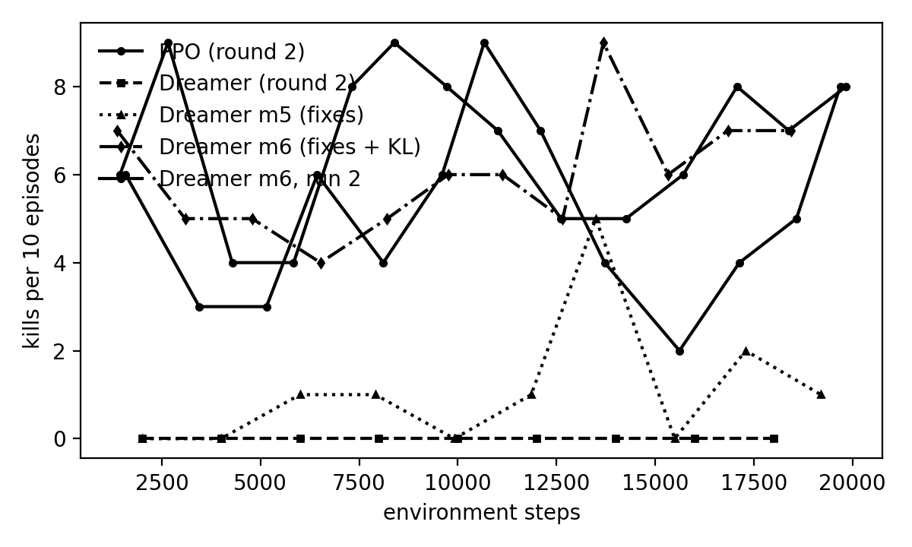
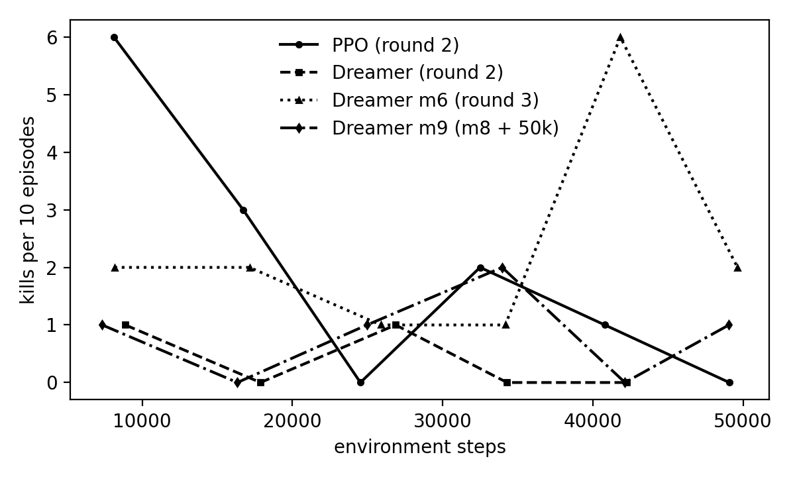

# Milestone 2 report — world model (Dreamer) vs PPO on vision-based hunting

*2026-11-04. Branch `extension/world-model-hunting`. Detailed logs, tables and plots: [`results/m2_demo_warmstart/README.md`](results/m2_demo_warmstart/README.md) (rounds 2–3) and [`results/m2_initial/README.md`](results/m2_initial/README.md) (round 1).*

## 1. Question and protocol

Hypothesis (Milestone 1): a DreamerV1-style world model learns the hunting task better and faster than model-free PPO, given the same inputs.

Task: `hunting_vision`. The agent sees a 224×224 camera frame through a frozen DINOv2 ViT-S/14 (17 tokens × 384) plus 11 proprioception numbers, chooses one of 12 discrete actions, and is rewarded for closing on, hitting and killing cows (+100 per kill, approach and aim shaping, −30 for pits and lava). Two stages:

1. **Warm-up**: flat walled arena, 1 cow, 200-step episodes, 20k env steps.
2. **Benchmark**: four natural biomes (meadow, plains with lava pools, tundra, desert with sinkholes), 3 cows, hazards, 900-step episodes, 50k env steps from the warm-up checkpoint. Forest is held out for evaluation.

Both agents get exactly the same: inputs, actions, rewards, the same 60 scripted demonstrations (50 kills), the same behaviour-cloning warm start, the same training-time privileged labels (cow bearing, distance, in-range) through an auxiliary head, the same step budgets, three Minecraft clients in lockstep. The only difference is the model in the middle: a feed-forward policy trained by PPO, or a recurrent latent world model trained by reconstruction and a policy trained inside its imagination.

## 2. Headline results

### Warm-up (20k steps)

| Agent | Kill episodes | Steps to first 50% window | Trend |
|---|---|---|---|
| PPO | 52% (67 / 130) | 1,584 | flat |
| Dreamer, round 2 (as of 2026-11-03) | 1% (1 / 99) | never | collapsed |
| **Dreamer, round 3, run 1** | **60% (78 / 129)** | 1,370 | rising (67% second half) |
| **Dreamer, round 3, run 2** | **67% (94 / 140)** | 1,440 | 66% second half |



### Benchmark (50k steps, four biomes)

| Agent | Kills in 60 episodes | Steps to first 20% window | Mean reward, first → last third |
|---|---|---|---|
| PPO | 12 | 8,115 | +47 → −22 (forgets its warm start) |
| Dreamer, round 2 | 2 | never | −42 → −55 |
| **Dreamer, round 3** | **14** | 8,147 | −13 → **+43** (still improving) |
| Dreamer, round 3 + 10k steps with hazard data | 6 kills in 10 episodes, mean reward +73 | | |



### Greedy evaluation (10 episodes per row; 20 where pooled)

| World | PPO | Dreamer round 3 (best checkpoint) |
|---|---|---|
| training mix | 0 kills, −49 | **3 kills in 20, +19**; stochastic 2 in 10, +35; veto planner 2 in 10, +24 |
| forest (held out) | 0, −22 | 0, −27 |
| plains (lava) | 0, −29 | 0, −17; veto planner **1 kill**, −6 |

Verdict: on the shared protocol the world-model agent now matches PPO's sample efficiency on the hard worlds (same step count to the 20% window), beats it on the warm-up (60–67% vs 52%), keeps improving where PPO degrades, and is the only agent with evaluation kills. Neither agent generalises to the held-out forest yet. Best checkpoint: `malmo/rl/checkpoints/dreamer_video_hunting_vision_dreamer_video_10k_m8haz_ep202_final.pt`.

## 3. What was wrong, and what fixed it

Round 2's Dreamer failed (1 kill in 99 episodes) while over-rating its own imagined rewards (+0.5/step imagined vs −0.05 real). An offline probe (`malmo/rl/evaluation/latent_probe.py`: ridge regression from the RSSM latent to the cow's true bearing on held-out demos, and the reward head's answer for each action with the cow in vs out of range) found the mechanism:

1. **The latent was blind to the cow** (bearing R² ≈ 0). The only training signal was DINOv2-token reconstruction, a per-element mean over 6,528 values dominated by grass, wall and sky; nothing in the loss cared about a cow-sized object.
2. **The reward head took the action shortcut**: `reward(feat, action)` with demo rows where `attack` coincides with +20/+100 learned "attack pays" unconditionally (+4/step even out of range), and the blind latent could not let real data correct it.
3. **Imagination then rewarded blind attacking**, the critic bootstrapped it to V ≈ 366 on states whose true return-to-go is ≤ 145, and the policy collapsed.
4. **The BC warm start did not transfer** (500 updates on features that were being re-trained underneath it).

Fixes, each checked with the probe before any live run, in order of measured effect:

| Change | Effect |
|---|---|
| KL term re-weighted (`WM_KL_SCALE` 1 → 0.1, free nats 1 → 3) so the posterior carries ~4 nats/step instead of 1 | warm-up 12% → 60%; bearing R² 0.62 → 0.76 |
| Privileged aux head kept for **both** agents (PPO got the same head) | bearing R² ~0 → 0.62 |
| Reward/continuation heads read the next latent state (no action input) + 5-head reward ensemble with pessimism | optimism gap +0.5/step → ~0 |
| BC warm start on a frozen world model, 2000 updates, constant 0.1 anchor | teacher match 77% → 87% |
| Scripted hazard episodes (36, walking into pits/lava) in the world-model batch | planner pit deaths 4 → 0; policy 6 kills in 10 fine-tune episodes |
| Lookahead planner overrides the actor only with a reason (`PLAN_MODE="veto"`) | planner −56 → +24 on the training mix |

Negative results kept on record: decaying the BC anchor and cutting the demo share on the hard worlds (0 kills in 30 episodes); the pure argmax planner (loses through hazard deaths, then through over-rating `look_down`/`attack`); continuing the best checkpoint for 50k more steps (regressed to 5 kills in 60: a run's peak is not yet stable under long continuation).

## 4. The planner (our addition to DreamerV1)

Imagining several futures per candidate action at play time hurt in every configuration where it could freely override the actor: the world model has almost no hazard endings in its data, so dreams that walk into a pit look fine, and the best of 4 × 8 noisy rollouts is biased upward. With hazard episodes in the data the restricted planner stopped dying in pits but still lost (its 8-step scoring rated `look_down` above turning toward the cow). Requiring a reason to override (veto when the actor's own choice ends the episode in imagination) makes it level with or slightly above the plain policy and gave the only plains kill of any evaluation, at +12 ms per action. That is "no longer harmful, possibly helpful": ten-episode evaluations are too noisy to call it a gain.

## 5. Caveats

- Two warm-up runs, one full benchmark run per agent; evaluations are 10 episodes per cell. The benchmark replicate was stopped at 7 episodes.
- PPO's benchmark was run on 2026-11-03, before the shared-code fixes (all protocol-neutral; a PPO re-run would make the comparison airtight).
- "Fair" includes training-time privileged labels for both agents (asymmetric actor-critic style); inputs at test time are pixels and proprioception only.
- Tundra and the held-out forest have no kills for either agent.

## 6. Reproduction

```
# env servers (conda malmo), one per Minecraft client; MALMO_HUNT_LEVEL=0 flat arena, 1 four biomes
MALMO_HUNT_LEVEL=0 python malmo/rl/envs/env_server.py --env hunting_vision --port 9990 --malmo-port 10010
# warm-up (conda train_env)
python malmo/rl/training/train.py --env hunting_vision --algo dreamer_video --fair --num-envs 3 --base-port 9990 \
  --demo-path malmo/demos/hunting_vision_L0_m3 --pretrain-wm-steps 2000 --bc-pretrain-steps 2000 \
  --max-env-steps 20000 --viz-port 8765 --run-tag warm
# benchmark from the warm checkpoint (servers restarted with MALMO_HUNT_LEVEL=1)
python malmo/rl/training/train.py --env hunting_vision --algo dreamer_video --fair --num-envs 3 --base-port 9990 \
  --demo-path malmo/demos/hunting_vision_L0_m3 --checkpoint <warm_final.pt> --max-env-steps 50000 \
  --cfg DEMO_BC_DECAY=False --cfg HAZARD_DEMO_PATH=malmo/demos/hunting_vision_cow_L1_hazard --run-tag bench
# offline gate (no Malmo): latent readout, reward-head shortcut, BC agreement
python malmo/rl/evaluation/latent_probe.py --pretrain --fair --demo-path malmo/demos/hunting_vision_L0_m3
# evaluation
python malmo/rl/evaluation/evaluate_hunting.py --algo dreamer_video --checkpoint <ckpt> --episodes 10 [--plan] [--stochastic]
# live viewer while training: http://localhost:8765/ (also over Tailscale: tailscale serve --bg 8765)
```

All round-3 settings are the `hunting_vision` defaults (`malmo/rl/training/configs/hunting_vision_cfg.py`, with the evidence in the comments). Nothing from this round is committed yet; checkpoints, demos and logs are outside git.
