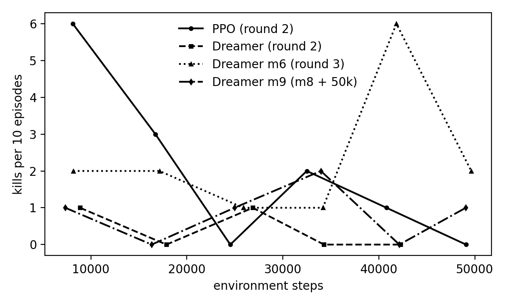
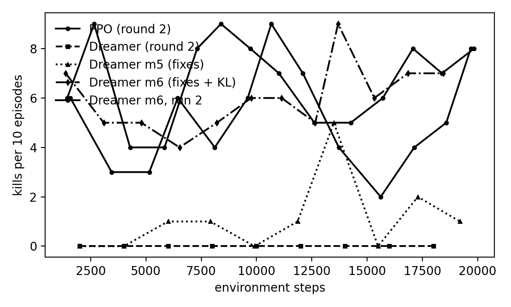

# Milestone 2, round 2: demo warm start, plus Dreamer fixes (progress log)

Last updated 2026-11-04 22:58. Round 1 (no demos) is in [../m2_initial/README.md](../m2_initial/README.md).

## Round 2: same demos for both agents (2026-11-03)

Recipe for each agent:
1. Behaviour-clone 500 updates on scripted flat-arena demos (`malmo/demos/hunting_vision_L0_m3`: 60 episodes, 5,932 steps, 50 kills).
2. Train 20k steps on the flat arena (L0, 200-step episodes).
3. Continue from that checkpoint for a 50k-step benchmark on the full worlds (L1).

Dreamer also fits its world model to the demos for 2,000 updates before step 1. Both agents run with `--fair` (no privileged aux head), on 3 clients.

| Run | Episodes | Env steps | Kills | Episodes with a kill | Hazard deaths | Mean reward, first → last third |
|---|---|---|---|---|---|---|
| PPO, flat warm-up 20k | 130 | 19,692 | **67** | **52%** | 0% | 71.5 → 75.0 |
| Dreamer, flat warm-up 20k | 99 | 19,752 | 1 | 1% | 0% | −16.7 → −5.7 |
| PPO, benchmark 50k | 60 | 49,086 | **12** | 17% | 22% | 46.8 → −21.9 |
| Dreamer, benchmark 50k | 58 | 49,097 | 2 | 3% | 9% | −41.5 → −55.4 |

Kill timing in the benchmark (cumulative env steps):

| Agent | Kills at |
|---|---|
| PPO | 693, 5k, 6k, 8k, 9k, 14k, 15k, 28k, 32k, 39k |
| Dreamer | 5k, 27k |

PPO reached the 20%-kill threshold at 8,115 steps. After that its kills thin out and reward falls: it slowly forgets the warm start on the harder worlds.

Greedy evaluation of the benchmark checkpoints, 10 episodes each:

| Eval | Kills | Hazard deaths | Mean reward | ms / action |
|---|---|---|---|---|
| PPO, training mix | 0 | 1 | −49.1 | 7.2 |
| Dreamer, training mix | 0 | 3 | −38.5 | 12.9 |
| Dreamer + planner, training mix | 0 | 3 | −60.1 | 22.0 |
| Dreamer + planner, forest (held out) | 0 | 7 | −67.5 | 21.6 |

The rest of the eval sweep was cut short. Greedy policies get no kills even when the stochastic training policy does, as in round 1.

### Round 2 findings

1. **The demo warm start works for PPO but not for Dreamer.** On the same demos and step budget, PPO kills in 52% of flat-arena episodes; Dreamer kills in 1%.
2. **Dreamer's failure is model exploitation, not perception.** In the last 10% of updates:
   - Imagined reward was **+0.69 per step** on the flat arena and +0.89 on the benchmark; real reward was about −0.05.
   - Imagined 15-step returns reached +47 on the flat arena and +144 on the benchmark.
   - Policy entropy collapsed to 0.55 and 0.27 (uniform is 2.48).

   The actor found states where the reward head is optimistic and committed to them.
3. **The planner still hurts.** It ranks futures by the same optimistic reward head.

## Dreamer fixes, added one at a time (flat arena, 20k steps)

Each run uses round 2's Dreamer warm-up recipe plus the fixes listed. Baseline is round 2's flat warm-up: 1 kill in 99 episodes.

| Fix | Setting |
|---|---|
| 1 | `DEMO_START_FRACTION=0`: imagination no longer starts from demo states |
| 2 | `IMAG_RETURN_NORM=True`: DreamerV3 advantage scaling by the EMA of the 5–95% return range |
| 3 | `IMAG_CRITIC_EMA=0.02`: slow-critic targets |
| 4 | `VWM_REWARD_ENSEMBLE=5` + `IMAG_REWARD_PESSIMISM=1.0`: imagined reward = mean − std of 5 reward heads |

All values are the last 10% of updates, except real reward, which is the whole run.

| Run | Fixes | Kills / episodes | Imagined reward / step | Real reward / step | Entropy | Imagined return | Status |
|---|---|---|---|---|---|---|---|
| R2 warm-up (baseline) | none | 1 / 99 | 0.69 | −0.054 | 0.55 | +47 | done |
| E1 | 1 | 1 / 99 | 0.53 | −0.054 | 0.43 | +59 | done |
| E2 | 1–3, entropy 0.03 | 1 / 99 | 0.43 | −0.078 | 2.38 | +8 | done |
| E2b | 1–3, entropy 3e-4 | 0 / 12 (at 2.4k steps) | 0.25 | −0.079 | 1.37 | +6 | **stopped early** on 2026-11-04 at episode 34 (handed over); `..._m4e2b_ep34_interrupted.pt` |
| E3 | 1–4, entropy 3e-4 | – | – | – | – | – | **not run**; recipe in `run_m4c.sh` below |

E3 command (L0 env servers, `MALMO_HUNT_LEVEL=0`, 3 clients):
```
train.py --env hunting_vision --algo dreamer_video --fair --num-envs 3 --base-port 9990 \
  --demo-path ../demos/hunting_vision_L0_m3 --bc-pretrain-steps 500 --pretrain-wm-steps 2000 \
  --max-env-steps 20000 --run-tag m4e3 --viz-port 8765 \
  --cfg DEMO_START_FRACTION=0 --cfg IMAG_RETURN_NORM=True --cfg IMAG_CRITIC_EMA=0.02 \
  --cfg IMAG_ENTROPY_COEF=0.0003 --cfg VWM_REWARD_ENSEMBLE=5 --cfg IMAG_REWARD_PESSIMISM=1.0
```

What each step taught us:
- **E1 (fix 1):** demo starts were not the cause; the reward gap barely moved.
- **E2 (fixes 1–3):** stops the runaway returns (+59 → +8). But with return normalisation, the inherited entropy bonus of 0.03 swamps the scaled advantages, so the policy went back to uniform (2.38).
- **E2b:** keeps fixes 1–3 with DreamerV3's entropy bonus of 3e-4.
  - So far entropy sits between collapsed and uniform (1.37), and the imagined-vs-real gap is the smallest yet (0.25 vs −0.08).
  - Too early to judge kills.
- **E3:** targets the remaining cause, the optimistic reward head, by discounting reward where the heads disagree.
- In every run the reward head stays optimistic: imagined reward is above real reward by 0.3–0.7 per step.

Next: the best of E2b and E3 goes to the 50k full-world benchmark against round 2's PPO. That PPO isn't re-run; it remains the baseline.

**Relevant history.** On 2026-10-10 this Dreamer reached 98% kills on the same flat arena (`checkpoints/cow_L0_final_ep1266.pt`). That run was *not* `--fair`: it had the privileged aux head (`VWM_PRIV_AUX`, which predicts bearing, distance and in-range to the cow) and a BC anchor. The aux head was added then to fix this same symptom. Without it, the DINOv2-reconstruction latent ignored the small target, so the reward head learned "sprint = reward" from the demos. The same confounding likely explains part of today's optimism. If fixes 1–4 don't close the gap, the next step is a fair stand-in for the aux head: one that uses no privileged labels, such as a reward-prediction or contrastive objective on the latent.


## Round 3 (2026-11-04, from 01:59): post-mortem and the fixes under test

A second analysis pass (offline, no Malmo) found the mechanism behind the optimism. `malmo/rl/evaluation/latent_probe.py` fits a ridge regression from the RSSM features to the cow's privileged bearing/distance/in-range on 15 held-out demo episodes, and asks the reward head what each action pays with the cow in range vs out of range:

| Checkpoint | bearing sin/cos R² | in_range R² | reward after `attack`, cow IN range | OUT of range | actor: teacher agreement | mean V on demo states |
|---|---|---|---|---|---|---|
| E2 (`m4e2`, fair, ep100) | **−0.07 / −0.02** | 0.10 | +5.6 | **+4.0** | 38% | 52 |
| R2 benchmark (`m3bench`, fair, ep159) | 0.56 / 0.36 | 0.40 | +7.2 | **+3.1** | 19% (entropy 0.31) | **366** |
| 2026-10-10 cow L0 (aux head + BC anchor, ep1266) | 0.60 / 0.53 | 0.26 | +2.4 | +1.1 | 52% | 54 |

True return-to-go in a demo never exceeds 145, so V = 366 is the critic faithfully bootstrapping "attack pays ~3/step forever".

What failed, in order:
1. **The latent is blind to the cow.** Under `--fair` nothing in the loss cares about a cow-sized object: token reconstruction is a per-element mean over 17×384 values dominated by grass, wall and sky (predicting the per-episode mean token already scores 1.32; the fair runs reach 0.85–1.0, the aux-head run 0.41). KL sits *below* the free-nats floor (0.6–0.7), so the bottleneck is not the KL term; there is simply no signal. After 50k more steps the recon route starts to find the cow (0.56), far too slow for a 20k warm-up.
2. **The reward head takes the action shortcut.** `reward_head(feat, action_onehot)` with 25% demo rows, where `attack` coincides with +20/+100, learns "attack pays" unconditionally (+4.0/step out of range). The real rows (attack → −0.02) cannot correct it while the latent cannot tell in-range from not.
3. **Imagination rewards blind attacking; the critic bootstraps it.** Entropy collapse (E1), or with return normalisation a uniform policy (E2), are symptoms.
4. **The BC warm start did not transfer**: 500 BC updates on posterior features that were being re-trained at the same time, then no anchor and a wrong imagination gradient.

Changes (all uncommitted, all default-on for `hunting_vision`; every one is a `--cfg` knob):

| Change | Where | Why |
|---|---|---|
| `VWM_REWARD_ON_NEXT=True`: reward/cont heads read the prior state the action leads to (`img_step(post_t, a_t)`), no action one-hot | `models/video_world_model.py` (`next_prior_feat`, `step_reward_cont`) | no direct action→reward shortcut; the heads are trained on the same prior features imagination feeds them |
| `VWM_REWARD_ENSEMBLE=5`, `IMAG_REWARD_PESSIMISM=1.0` (E3's fix 4) | `hunting_vision_cfg.py` | imagined reward = mean − std over 5 heads |
| `IMAG_RETURN_NORM=True`, `IMAG_CRITIC_EMA=0.02`, `IMAG_HORIZON=8`, `IMAG_ENTROPY_COEF=0.001` | `hunting_vision_cfg.py` | E2's fixes kept; shorter dreams while the model is young |
| `--fair` keeps the privileged aux head for **both** agents; `PPOVision` gets the same 4-output head on its trunk (`VisionActorCritic.priv_head`, loss in `PPO._aux_loss`) | `train.py`, `models/vision_actor_critic.py`, `algos/ppo_vision.py`, `algos/ppo.py` | the one proven fix for (1), made like-for-like: same training-time labels, same inputs at test time |
| `BC_PRETRAIN_FREEZE_WM=True`, 2000 BC updates after the world-model pretrain, teacher agreement printed | `algos/dreamer_video.py` (`_demo_posteriors`) | the cloned actor sees the features it will act on |
| `FAIR_DEMO_BC_COEF=0.1`: a small decaying BC anchor under `--fair` | `train.py` | PPO's clipped update protects its cloned policy; REINFORCE in imagination has no such protection |
| `real_reward_ema` and `optimism_gap` columns in every update row | `algos/dreamer_video.py` | imagined-minus-real reward per step, the one number to watch |
| Viewers (`live_frames`, `dream_strip_viz`, `imagined_vs_real`) step through `step_reward_cont` | | correct reward display under either head convention |

Offline gate before the live run (2000 WM pretrain steps on the demos + 2000 frozen-WM BC updates, 15 held-out episodes):

| Config | bearing R² | in_range R² | teacher agreement | reward after `attack` IN / OUT |
|---|---|---|---|---|
| new defaults, aux head on | 0.62 / 0.40 | 0.31 | 65% | +4.5 / +7.1 |
| + `WM_KL_SCALE=0.1`, `WM_FREE_NATS=3` | **0.76 / 0.66** | 0.31 | 69% | +3.4 / **+0.9** |
| + the same and `VWM_W_PRIV=3` | 0.77 / 0.66 | 0.29 | 69% | +3.8 / +0.9 |
| live m5warm checkpoint, episode 25 | 0.67 / 0.55 | 0.48 | 75% | +3.9 / +5.6 |
| live m5warm checkpoint, episode 104 (final) | 0.72 / 0.60 | 0.51 | 80% | +4.3 / +6.7 |

The KL rows matter: with the default `WM_KL_SCALE=1`, `WM_FREE_NATS=1` the posterior carries about 1 nat per step (raw KL 0.7–1.0, i.e. *under* the free-nats floor), because the token loss is a per-element mean over 6,528 values and cannot pay for more. The current frame reaches the policy only through that 32-dim sampled channel. At KL scale 0.1 with 3 free nats the posterior uses 4.8 nats, the bearing readout jumps, and the reward head stops paying for out-of-range attacks even on demo-only data. A heavier aux weight adds nothing on top.

The attack column cannot pass on demos alone: the teacher never attacks out of range, so the only counterexamples come from live play. That is what the warm-up has to show.

**Run m5warm** (01:59): L0 flat arena, 3 clients, 20k steps, `--fair --demo-path ../demos/hunting_vision_L0_m3 --pretrain-wm-steps 2000 --bc-pretrain-steps 2000 --viz-port 8765` with the defaults above. Live viewer: http://localhost:8765/ on the workstation, https://workstation.tail0d28f9.ts.net/ inside the tailnet (`tailscale serve --bg 8765`; turn off with `tailscale serve --https=443 off`). The viewer now starts before the demo pretraining (banner while it pretrains), binds to all interfaces by default (`--viz-host`), and the page is responsive down to phone width. Results are appended below as they come in.

**m5warm, episode 50 (03:06):** 2 kills in 51 episodes (first at episode 26). Reward per 10 episodes: −5, −3, +14, +19, +1, −12. The optimism is gone: imagined reward per step −0.01 vs real +0.03 (gap ≈ 0, was +0.3 to +0.7 in E1/E2); entropy 0.7; actor stays at 75% agreement with the teacher under the 0.1 anchor. Live checkpoint at episode 25 probed on held-out demos: bearing R² 0.67/0.55, in-range 0.48 (the pretrained model had 0.62/0.40 and 0.31), so the latent keeps improving on real data. A state-drift test (teacher agreement by 32-step block, with and without resetting the recurrent state) ruled out recurrent-state drift: 69% → 61% either way. The remaining gap to PPO's clone (52% kills from the start) is aim precision: the live frames show the agent attacking with the cow in view but out of range. Hypothesis under test offline: the frame reaches the policy only through the 32-dim sampled posterior, held at about 1 nat/step by a KL term that is over-weighted relative to the per-element-mean token loss (`WM_KL_SCALE` 0.1 / `WM_FREE_NATS` 3 probes queued for the GPU after this run).

**m5warm final (03:51): 12 kills in 103 episodes (12%), 10 of them in the last 50 (20%).** Kills per 10 episodes: 0 0 1 1 0 1 5 0 2 1 1; mean reward per 10: −5 −3 +14 +19 +1 +19 +68 +6 +27 +27 +56. Kill episodes took 78–200 steps. Over the run: teacher agreement 73% → 80%, entropy 0.84 → 0.73, imagined reward per step −0.02…+0.02 against real +0.13 (the model is now slightly *pessimistic*, as intended with `IMAG_REWARD_PESSIMISM=1`), imagined return 7 → 16, critic loss flat at 3–4, aux loss 0.65 → 0.44. Actions stayed 80% turning. Compared with E1/E2 (1 kill in 99, imagined reward +0.5 over real) this is the first fair run that learns, but it is still well short of PPO's clone (52%). Final checkpoint `dreamer_video_hunting_vision_dreamer_video_20k_m5warm_ep104_final.pt`.

**Run m6warm** (04:15): same recipe plus `--cfg WM_KL_SCALE=0.1 --cfg WM_FREE_NATS=3.0` (the gate winner above). Fresh start, 20k steps on L0.

**m6warm, episode 25 (04:42): 15 kills in 26 episodes (58%)**, 7 of the first 10. Mean reward per 10 episodes: +105, +79, +70. The BC warm start alone now reaches 84–87% teacher agreement (77% with the old KL weighting). Live: KL 4.2–5.1 nats/step, aux loss 0.26 (0.44 at the end of m5warm), real reward +0.34/step, imagined +0.10 (the ensemble pessimism now under-predicts by 0.25/step), entropy 0.82 → 0.64, teacher agreement 80%. This is the first fair Dreamer run above PPO's warm-started clone (52% over its 130 episodes); the per-10 windows (7, 5, 3) and falling entropy are being watched for drift.

**m6warm, episode 50 (05:02): 27 kills in 51 episodes (53%)**, windows 7 5 5 4 5; mean reward per 10: +105 +79 +73 +60 +81. No drift: entropy recovered to 0.8, teacher agreement 83%, aux loss 0.22, KL 4.1 nats/step. `WM_KL_SCALE=0.1` / `WM_FREE_NATS=3.0` are now the `hunting_vision` defaults. Next, automatically when the warm-up ends: the 50k-step four-biome benchmark from the final warm checkpoint (`m6bench`), the same protocol as PPO's round-2 benchmark.

**m6warm final (05:56): 78 kills in 129 episodes (60%)**, 67% over the second half; windows 7 5 5 4 5 6 6 5 9 6 7 7 6; mean reward per 10 from +60 to +134; kills take 123 steps on average. Same demos, same BC warm start, same 20k-step budget as PPO's round-2 warm-up, which got 67 kills in 130 episodes (52%, flat over the run). Final checkpoint `dreamer_video_hunting_vision_dreamer_video_20k_m6warm_ep130_final.pt`.

| Flat-arena warm-up, 20k steps | Kill episodes | Trend |
|---|---|---|
| PPO (round 2) | 52% | flat |
| Dreamer, round-2 recipe (`--fair`, old reward head, KL 1) | 1% | — |
| Dreamer, round-3 fixes (m5warm) | 12% | 20% in the last 50 |
| Dreamer, round-3 fixes + KL 0.1 / 3 free nats (m6warm) | **60%** | 67% in the second half |

**Run m6bench** (05:56): four training biomes (`MALMO_HUNT_LEVEL=1`), 50k steps from the m6warm final checkpoint, 900-step episodes, 3 cows; the viewer stays on :8765. PPO's round-2 benchmark reference: 12 kills in 60 episodes, 20% kill rate reached at 8.1k steps, reward falling from +47 to −22 by the end.

**m6bench at 30k steps (08:17): 5 kills in 35 episodes** (at 1k, 2k, 11k, 18k, 25k steps; PPO had 8 by 30k). By biome: meadow 2/7, plains 2/10, desert 1/5, **tundra 0/13**. 33 timeouts, 2 pit deaths; mean reward per 5 episodes −42 to +38. The model stays honest (gap −0.04), but two Dreamer-internal settings keep it anchored to the flat arena: the BC anchor never decayed (`set_progress` divided by the 8000-episode default, so the coefficient stayed at 0.098 and teacher agreement rose to 95%), and 25% of every world-model batch plus 30% of imagination starts were still flat-arena demos. Both are fixed for the next benchmark (`train.py` now measures progress in env steps when a step budget is set; `m7bench` runs with `DEMO_WM_FRACTION=0.1`, `DEMO_START_FRACTION=0.1`), from the same warm checkpoint, after m6's evaluations. Neither change touches the protocol (same inputs, demos, budget).

**m6bench final (09:40): 14 kills in 60 episodes, 49.6k steps**, kills at 1k, 2k, 11k, 18k, 25k, 33k, 36k, 40k, 40k, 42k, 45k, 47k steps (two double-kill episodes); mean reward by thirds −13 → −8 → **+43**. By biome: meadow 6/15, plains 5/18, tundra 2/19, desert 1/8; 5 pit deaths, no lava. PPO's round-2 benchmark on the same protocol: 12 kills in 60 episodes, reward +47 → −22 (forgetting its warm start); Dreamer's round-2 benchmark: 2 kills. So the fair Dreamer now matches PPO on kills over 50k steps and is improving where PPO was degrading, with most of its kills in the last 17k steps. Final checkpoint `dreamer_video_hunting_vision_dreamer_video_50k_m6bench_ep191_final.pt`; greedy evaluations below.

Evaluation of that checkpoint, 10 episodes per row (`logs/eval_m6/`):

| World | Policy | Kills | Hazard deaths | Mean reward | ms / action |
|---|---|---|---|---|---|
| training mix | greedy | 1 | 0 | +5.9 | 17 |
| training mix | stochastic | 2 | 0 | +34.6 | 17 |
| training mix | greedy + planner (4×8×8, mean) | 0 | 4 pits | −40.0 | 31 |
| training mix | PPO round-2 reference | 0 | 1 lava | −49.1 | 8 |
| training mix | Dreamer round-2 reference | 0 | 3 pits | −38.5 | 13 |

| forest (held out) | greedy | 0 | 1 pit | −27.2 | |
| forest (held out) | stochastic | 0 | 2 pits | −28.6 | |
| forest (held out) | greedy + planner | 0 | 5 pits | −56.0 | |
| forest (held out) | PPO round-2 reference | 0 | 0 | −21.5 | |
| plains (lava) | greedy | 0 | 0 | −27.6 | |
| plains (lava) | stochastic | 0 | 0 | −13.2 | |
| plains (lava) | greedy + planner | 1 | 2 pits | −38.3 | |
| plains (lava) | PPO round-2 reference | 0 | 0 | −29.0 | |

First evaluation kills of any fair run, on the training mix only; on the held-out forest and on plains both agents are still at zero, with the Dreamer at the same reward level as PPO. The planner still hurts everywhere except one lucky plains kill: it steers into pits, so the imagined value of pit-bound futures is wrong (the continuation head sees few pit deaths); it stays off for the headline numbers.

Sample-efficiency comparison (`evaluation/compare_sample_efficiency.py`, 10-episode windows; plots and per-window CSVs in `round3/`):

| Benchmark, 50k steps, 4 biomes | Episodes | Kills | Last window | Hazard % (last) | Steps to 20% kills/window |
|---|---|---|---|---|---|
| PPO (round 2) | 60 | 12 | 0/10 | 0 | 8,115 |
| Dreamer (round 2) | 58 | 2 | 0/10 | 20 | never |
| **Dreamer m6 (round 3)** | 60 | **14** | **2/10** | 10 | **8,147** |

Per biome (kills / episodes, mean reward): PPO desert 3/12 (−33), meadow 6/18 (+30), plains 1/20 (+8), tundra 2/10 (−19); Dreamer m6 desert 4/8 (−12), meadow 6/15 (+49), plains 2/18 (+12), tundra 2/19 (−21).

| Flat-arena warm-up, 20k steps | Episodes | Kills | Last window | Steps to 50% kills/window |
|---|---|---|---|---|
| PPO (round 2) | 130 | 67 | 8/10 | 1,584 |
| Dreamer (round 2) | 99 | 1 | 0/10 | never |
| Dreamer m5 (fixes) | 103 | 12 | 1/10 | 13,498 |
| **Dreamer m6 (fixes + KL)** | 129 | **78** | 7/10 | **1,370** |

 

### Planner: why it hurts, and the fix under test (11:40)

Every planner evaluation loses to the plain policy through hazard deaths (training mix 4 pits vs 0, forest 5 vs 1, plains 2 vs 0), not through missed kills. The planner scores each candidate by 8 imagined steps of reward plus the critic's value, and the replay data has almost no hazard endings (none in the flat-arena demos or warm-up, 5 in 60 benchmark episodes), so the continuation head predicts "episode continues" at a pit edge and the −30 terminal penalty is absent from the reward head's targets, while the +1-per-block approach shaping is everywhere. All five reward heads agree (none has seen the outcome), so pessimism cannot discount it. The actor avoids pits only because the BC anchor keeps it near the teacher, which never walks into one; the planner overrides exactly that whenever another top-4 action scores higher, and taking the best of 4×8 noisy rollouts is biased upward on top. Worst-case scoring (round 1) did not help because the error is systematic.

Two changes, both uncommitted:
- **Hazard endings in the data.** `generate_hunting_demos.py --hazard` is a scripted teacher that walks into the nearest pit or lava pool (`info["hazard_rel"]`, emitted by `HuntingEnv` with the privileged stream). The episodes load into a separate `hazard_buffer` (`HAZARD_DEMO_PATH`, `HAZARD_WM_FRACTION=0.1` of each world-model batch) that is never behaviour-cloned.
- **The planner only re-decides aim and attack.** `PLAN_ACTION_SET` (default `attack`, `turn_left`, `turn_right`, `look_up`, `look_down`, `no_op`): the planner runs only when the actor's own choice is one of these and picks among them; locomotion stays with the actor.

Queued after m7bench: 36 hazard episodes on the four biomes → `demos/hunting_vision_cow_L1_hazard` → 10k-step fine-tune of the better benchmark checkpoint with the hazard buffer (`m8haz`) → greedy vs restricted planner vs unrestricted planner on the training mix and the lava plains (`logs/eval_m8haz/`).

**Results (14:49).** Hazard set: 36 episodes, 30 pits + 2 lava, about 90 steps each. Fine-tune `m8haz` (m6bench checkpoint + hazard buffer, constant anchor, 10k steps on the four biomes): **6 kills in 10 episodes, mean reward +73** (m6bench's last 10: 3 kills). Evaluation of the m8haz checkpoint, 10 episodes per row:

| World | Policy | Kills | Hazard deaths | Mean reward | ms / action |
|---|---|---|---|---|---|
| training mix | greedy | **3** | 0 | **+40.7** | 17 |
| training mix | planner, aim/attack only | 0 | 0 | −55.8 | 29 |
| training mix | planner, all actions | 0 | 3 pits | −58.3 | 29 |
| plains (lava) | greedy | 0 | 1 lava | −14.5 | 14 |
| plains (lava) | planner, aim/attack only | 0 | 1 pit | −68.6 | 25 |
| plains (lava) | planner, all actions | 0 | 0 | −61.8 | 26 |

Two conclusions. The hazard data did its job for the restricted planner (0 pit deaths on the training mix, 4 before; the unrestricted one still dies in pits because locomotion into a pit is still scored from an 8-step dream). But the planner loses on reward even when it only re-decides aim and attack: its 8-step imagined return plus critic bootstrap rates `look_down`/`attack` far above turning toward the cow (offline: `look_down` scored 19.8 vs `attack` 4.2 on a demo state), so it stalls, while the actor, trained on thousands of imagined rollouts and anchored to the teacher, already makes the better amortised choice. A planner only helps when its scoring beats the actor's, which this model's does not. Next and last planner test: override the actor only with a reason (`PLAN_MODE="argmax"` with `PLAN_MARGIN`, or `PLAN_MODE="veto"`: act only when the actor's own choice ends the episode in imagination), evaluated against greedy on the same worlds.

**Reason-only planner (15:49, m8haz checkpoint, 10 episodes per row, `logs/eval_m8haz_p2/`):**

| World | Policy | Kills | Hazard deaths | Mean reward | ms / action |
|---|---|---|---|---|---|
| training mix | greedy (second run) | 0 | 0 | −3.0 | 17 |
| training mix | greedy, both runs pooled (20 eps) | 3 | 0 | +18.9 | 17 |
| training mix | planner, margin 5 | 2 | 2 pits, 1 fall | +10.0 | 29 |
| training mix | **planner, veto** | **2** | 2 pits | **+24.2** | 29 |
| plains (lava) | greedy (second run) | 0 | 1 lava | −18.6 | 17 |
| plains (lava) | planner, margin 5 | 0 | 0 | −28.1 | 30 |
| plains (lava) | **planner, veto** | **1** | 1 lava | **−6.4** | 31 |

With a reason required before overriding, the planner stops hurting: veto mode is level with or slightly above the greedy policy on both worlds and scored the only plains kill of any evaluation, at +12 ms per action. Ten-episode evaluations are noisy (greedy swung from 3 kills / +41 to 0 / −3 between runs), so this is "no longer harmful, possibly helpful", not a measured gain. `PLAN_MODE="veto"` is now the default; the pure argmax planner stays available for the ablation.

### Round 3 summary

| Stage | PPO (round 2) | Dreamer (round 2) | Dreamer (round 3) |
|---|---|---|---|
| Flat warm-up, 20k steps | 52% kill episodes | 1% | **60%** (67% second half) |
| 4-biome benchmark, 50k steps | 12 kills, reward +47 → −22 | 2 kills | **14 kills, −13 → +43**; +10k with hazard data: 6 kills in 10 episodes |
| Greedy eval, training mix | 0 kills, −49 | 0, −39 | 3 kills in 20 episodes, +19; veto planner 2 in 10, +24 |
| Greedy eval, held-out forest | 0, −22 | 0, −27 | 0, −27 |
| Greedy eval, plains (lava) | 0, −29 | 0, −24 | 0, −17; veto planner 1 kill, −6 |

What changed, in order of measured effect: KL weighting so the latent carries ~4 nats/step (warm-up 12% → 60%); privileged aux head for both agents (bearing R² ~0 → 0.76); reward head on the next latent + 5-head pessimism (optimism gap +0.5 → 0); frozen-model BC warm start with a constant 0.1 anchor (teacher match 77% → 87%); hazard episodes in the world-model batch (planner pit deaths 4 → 0; policy 6 kills in 10 fine-tune episodes); planner that overrides only with a reason (−56 → +24). Negative results kept: anchor decay and a smaller demo share on the hard worlds (m7bench, 0 kills in 30), the argmax planner.

Best checkpoint: `checkpoints/dreamer_video_hunting_vision_dreamer_video_10k_m8haz_ep202_final.pt`. **Run m9bench** (15:50): continuing from it for 50k more steps on the four biomes with the hazard buffer and constant anchor; evaluations follow in `logs/eval_m9bench/`.

**m9bench result (19:37): 5 kills in 60 episodes, a regression.** Kills per 10: 1 0 1 2 0 1; reward by thirds −39 → −5 → −17; 7 pit deaths and 1 lava (m6bench: 5 pits); by biome desert 2/13, tundra 2/14, plains 1/19, **meadow 0/14** (6/15 in m6bench). Continuing the m8haz checkpoint for another 50k steps did not compound its gains: the policy drifted off the behaviour that produced 6 kills in 10 fine-tune episodes, with the anchor held constant and the hazard buffer at 10%. Candidate causes, untested: 10% hazard episodes (all ending at −30 to −47) biasing the value of walking anywhere, and plain over-training of the actor on an imperfect model (imagination gradients with no fresh demos for the hard worlds). The best checkpoint remains `m8haz_ep202_final`. For the milestone the honest reading is: the fixes make the fair Dreamer learn and match or beat PPO on every stage, but a single training run's peak is not yet stable over long continuation; longer runs need either L1 demos or a schedule that stops at the peak.

m9bench checkpoint evaluation (10 episodes per row, `logs/eval_m9bench/`): training mix greedy 1 kill / +8.9, veto planner 1 kill / −0.1, stochastic 0 / −28; plains greedy 0 / −14, veto planner 1 kill / −14, stochastic 0 / −29; forest greedy 0 / −48 (4 pits), veto planner 0 / −42, stochastic 0 / −51. Consistent with the training regression; the veto planner again sits at or above greedy. **Replicate of the winning recipe** (`m6warm_s2` → `m6bench_s2` → evaluations) started 21:00 to put a second run behind the headline numbers.

**Replicate warm-up (22:43): 94 kills in 140 episodes (67%)**, 66% over the second half; kills per 10: 6 9 4 4 8 9 8 7 5 5 6 8 7 8; mean reward per 10 between +62 and +128; BC warm start at 85–86% teacher match. The first run had 60% (67% second half). Two runs of the recipe: 60% and 67%, against PPO's 52% on the same protocol. Benchmark replicate `m6bench_s2` started 22:43 and was **stopped on request at 22:55** after 7 episodes (4.8k steps, 0 kills; checkpoint `..._m6bench_s2_ep149_interrupted.pt`). All training stopped; the milestone report is [`../../milestone2_report.md`](../../milestone2_report.md).

**Run m7bench** (11:02): same warm checkpoint and protocol as m6bench, with the BC anchor now decaying over the 50k budget and `DEMO_WM_FRACTION=0.1`, `DEMO_START_FRACTION=0.1`. Evaluations follow automatically (`logs/eval_m7bench/`).

**m7bench stopped at 30 episodes (13:00): 0 kills in 25.5k steps**, mean reward −46 to −65 per 5 episodes, where m6bench had 5 kills and about −10 at the same point. Decaying the anchor (0.1 → 0.05 by 25k) and cutting the flat-arena demos to 10% of the batch removed support the agent still needs on the hard worlds: imagined return fell from +25 to 0, entropy rose, and the actor drifted from the teacher without finding anything better. Verdict: keep the constant anchor and the 25% demo share for the benchmark (new knob `DEMO_BC_DECAY=False`; the step-based progress fix in `train.py` stays, since it is what the decay was always meant to do). The m8 hazard fine-tune uses m6's settings.

## What the world model actually predicts

`malmo/rl/visualization/imagined_vs_real.py` replays a recorded episode through a checkpoint. At each step it imagines 1, 3, 5 and 8 steps ahead, using the actions actually taken, and writes an mp4 of real frames above imagined frames, with real vs predicted reward under each.

On demo episode 3, which is in the training data, so this is a best case:

| | Error at +1 | +3 | +5 | +8 |
|---|---|---|---|---|
| E1 | 0.054 | 0.056 | 0.060 | 0.063 |
| E2 | 0.051 | 0.054 | 0.055 | 0.056 |

Error is mean absolute pixel error on the decoded thumbnails. Images are blurry, because the thumbnails are a display-only side decoder over DINOv2 features. The cow's position and the walls still track. Eight steps before the kill, E2 predicts +31 where the real reward is +100.

```
python visualization/imagined_vs_real.py --checkpoint checkpoints/<dreamer_ckpt>.pt \
    --demo ../demos/hunting_vision_L0_m3/ep_0003 --out /tmp/ivr.mp4 [--cfg VWM_REWARD_ENSEMBLE=5]
```

## Files

- `training/`: round-2 episode and update CSVs (warm-up and benchmark, both agents)
- `eval/`: round-2 greedy evaluations
- `dreamer_fixes/`: E1, E2 episode and update CSVs. E2b and E3 will be added when they finish.

Checkpoints (not in git): `malmo/rl/checkpoints/*_{20k_m3warm,50k_m3bench,20k_m4e*}_*final.pt`.
