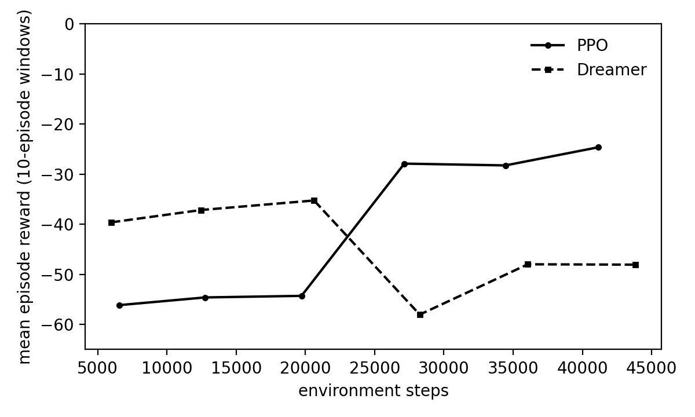

# Milestone 2 — initial benchmarks (2026-11-03)

First head-to-head of the model-free baseline (`ppo_vision`) and the world-model
agent (`dreamer_video`, DreamerV1-style RSSM) on `hunting_vision`, trained from
scratch with **no demos and no warm-up**. Use these as the initial Milestone 2
benchmark; the follow-up round (same flat-arena demos for both + a flat-arena
warm-up) is reported separately.

## Setup

| Setting | Value |
|---|---|
| Inputs (both) | frozen DINOv2 ViT-S/14 tokens (17 × 384) + 11 proprio numbers |
| Actions (both) | 12 discrete; auto-attack when aimed and in range |
| Budget | 50,000 env steps each, 3 Minecraft clients in parallel |
| Training worlds | meadow, plains (lava pools), tundra, desert (sinkholes); random per episode |
| Held-out world | forest (evaluation only) |
| Prey | 3 spawned cows + the worlds' natural pigs; 3 kills end an episode |
| Kill detection | Minecraft's `MobsKilled` stat + entity id (`KILL_ORACLE`) |
| Episode length | up to 900 steps (`MISSION_TIME_LIMIT_MS` = 20 min, so the step limit governs) |
| Dreamer | `--fair`: no privileged aux head, no demos, no behaviour cloning |
| PPO | rollout 510 steps (512 rounded to a multiple of 3 envs) |

Commands:

```
train.py --env hunting_vision --algo ppo_vision           --num-envs 3 --max-env-steps 50000
train.py --env hunting_vision --algo dreamer_video --fair --num-envs 3 --max-env-steps 50000
evaluation/evaluate_hunting.py --algo {ppo_vision,dreamer_video} [--fair] [--plan [--plan-score worst]] --episodes 10
```

## Training results (50k steps each, stochastic policy)

| | PPO | Dreamer |
|---|---|---|
| Episodes | 69 | 69 |
| Kills | **2** | **3** |
| Episodes ended by a hazard | 25 | 22 |
| Mean reward, first → last third | −55.9 → −14.7 | −39.4 → −44.2 |
| Wall-clock | 2.4 h | 3.4 h |

Per biome (all training episodes):

| Biome | Agent | Episodes | Kills | Hazard deaths | Mean reward |
|---|---|---|---|---|---|
| desert (sinkhole) | PPO | 12 | 0 | 83% | −78.2 |
| | Dreamer | 10 | 1 | 80% | −58.7 |
| meadow | PPO | 21 | 0 | 38% | −2.6 |
| | Dreamer | 24 | 1 | 21% | −32.3 |
| plains (lava) | PPO | 19 | 1 | 26% | −39.6 |
| | Dreamer | 17 | 0 | 35% | −47.9 |
| tundra | PPO | 17 | 1 | 12% | −37.4 |
| | Dreamer | 18 | 1 | 17% | −49.4 |



## Evaluation (10 greedy episodes per row)

| World | Agent | Kills | Hazard deaths | Mean reward | ms / action |
|---|---|---|---|---|---|
| training mix | PPO | 0 | 4 / 10 | −21.2 | 7.8 |
| | Dreamer | 0 | 0 / 10 | −30.5 | 12.2 |
| | Dreamer + planner | 0 | 5 / 10 | −57.9 | 24.3 |
| forest (held out) | PPO | 0 | 0 / 10 | −21.5 | 7.7 |
| | Dreamer | 0 | 3 / 10 | −25.5 | 13.2 |
| | Dreamer + planner | 0 | 4 / 10 | −80.1 | 23.1 |
| plains (lava) | PPO | 0 | 0 / 10 | −29.0 | 7.8 |
| | Dreamer | 0 | 0 / 10 | −24.3 | 13.2 |
| | Dreamer + worst-case planner | 0 | 0 / 10 | −63.2 | 22.3 |

Planner settings: 4 candidate actions × 8 imagined futures × 8 steps; score =
discounted predicted reward + critic value; `mean` or `worst` over futures.

The forest and plains rows were run after the pit-detection fix (below); the
training-mix rows were run before it, with the old check. The first forest
round (old check) was void and is not included.

## Findings

1. **Neither agent learned to hunt in 50k steps** (2 vs 3 kills). The
   sample-efficiency comparison is inconclusive at this budget.
2. **PPO learned to lose less, not to hunt.** Reward rose from −56 to −25 per
   window, mostly from fewer early deaths; action entropy fell 2.44 → 2.26.
3. **Dreamer's world model learned to see but not to score.** Feature error
   1.54 → 1.16 and proprio error 2.67 → 0.21, but reward loss flat (0.10 → 0.11):
   3 kills in the replay buffer is too little to learn a kill reward. Imagined
   returns stayed negative and the actor stayed near uniform (entropy 2.36 of a
   possible 2.48).
4. **The lookahead planner hurt in every world** (and costs ~10 ms per action).
   It ranks futures by predicted reward, which this model cannot predict yet, so
   this does not test the planner idea; it needs a checkpoint whose reward loss
   has dropped.
5. **Kills are the bottleneck.** A kill needs 3 hits on a fleeing 10-HP animal;
   a near-random policy almost never gets one. The desert sinkhole also ends
   ~80% of desert episodes.

## Bugs found and fixed during this round

- **Kill detection** used to infer a kill when a hit animal left sensor range.
  Replaced by an oracle: the player's `MobsKilled` stat rose *and* a prey animal
  that was within reach last step is gone or at 0 health. Verified live against
  Minecraft's own count (4/4 kills, 0 mismatched steps).
- **Pit detection** flagged any hillside as a pit (ground 2–3 blocks away ≥ 2
  higher). False pits on open ground: forest 52% (including the spawn),
  desert 10%, plains 8%, meadow 3%, tundra 1%. Now a pit means the agent cannot
  walk out (no path of ≤ 1-block rises reaching 5 blocks away): 0 false pits in
  the training biomes, every sinkhole and pit floor still detected. **The 50k
  training runs above used the old check**, which affected both agents equally.
- Episodes were cut by the 150 s mission timer at ~200–270 steps (and at
  different lengths for the two agents); raised to 20 min for `hunting_vision`.
- Dreamer crashed at its first update when no episode had finished yet
  (900-step episodes); it now waits for one.

## Files

- `training/*_episodes.csv` — per training episode (with `world_seed` and `kills`)
- `training/*_updates.csv` — per update losses
- `training/windows_10ep.csv` — 10-episode window metrics
- `eval/*.csv` — per evaluation episode
- `compare_output.txt` — `compare_sample_efficiency.py --by-biome` output
- `reward_per_window.png`, `kills_per_window.png` — plots
- `report.html` — the same results as a page

Checkpoints (not in git): `malmo/rl/checkpoints/{ppo_vision,dreamer_video}_hunting_vision_*_50k_ep70_final.pt`.
