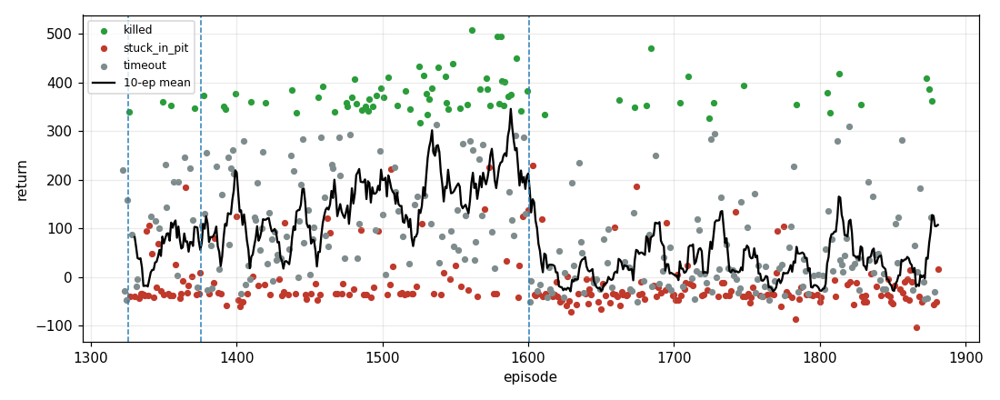

# Hunting training report (auto-generated)

Generated 2026-10-12 02:07. Episodes 1321-1881 (561 total), clock 00:48:19 -> 02:06:12.

## Headline

- Last 25 episodes: 12% finish all 3 cows, 52% end in a pit, mean return 38.
- Whole era: 14% 3-kill finishes, 42% pit endings, mean return 83.
- Best episode: #1561, return 508 (killed, 883 steps).

## By phase

| phase | episodes | 3-kill finish | pit end | early pit (<100 steps) | timeout | mean reward | reward >= 150 |
|---|---|---|---|---|---|---|---|
| pitch shaping + extreme-pitch penalty | 5 | 0% | 0% | 0% | 80% | 98 | 60% |
| + pit penalty / early end (pond present) | 50 | 8% | 60% | 26% | 30% | 58 | 20% |
| + pond filled with grass | 225 | 26% | 31% | 15% | 43% | 155 | 43% |
| multi-world (5 seeds) + random pits/ponds, pond unfilled | 281 | 6% | 47% | 14% | 46% | 30 | 12% |

## By 25-episode window

| episodes | episodes | 3-kill finish | pit end | early pit (<100 steps) | timeout | mean reward | reward >= 150 |
|---|---|---|---|---|---|---|---|
| 1321-1345 | 25 | 4% | 52% | 20% | 36% | 40 | 16% |
| 1346-1370 | 25 | 8% | 56% | 24% | 36% | 85 | 32% |
| 1371-1395 | 25 | 16% | 36% | 16% | 48% | 99 | 32% |
| 1396-1420 | 25 | 12% | 32% | 12% | 56% | 111 | 36% |
| 1421-1445 | 25 | 8% | 28% | 12% | 64% | 92 | 24% |
| 1446-1470 | 25 | 12% | 40% | 24% | 48% | 111 | 32% |
| 1471-1495 | 25 | 40% | 36% | 24% | 24% | 169 | 48% |
| 1496-1520 | 25 | 28% | 40% | 24% | 32% | 151 | 44% |
| 1521-1545 | 25 | 44% | 24% | 16% | 32% | 218 | 60% |
| 1546-1570 | 25 | 20% | 24% | 4% | 56% | 167 | 40% |
| 1571-1595 | 25 | 52% | 24% | 8% | 24% | 246 | 64% |
| 1596-1620 | 25 | 8% | 52% | 24% | 40% | 50 | 16% |
| 1621-1645 | 25 | 0% | 56% | 16% | 44% | 1 | 8% |
| 1646-1670 | 25 | 4% | 56% | 12% | 40% | 4 | 4% |
| 1671-1695 | 25 | 12% | 48% | 16% | 40% | 67 | 20% |
| 1696-1720 | 25 | 8% | 52% | 24% | 40% | 25 | 8% |
| 1721-1745 | 25 | 8% | 32% | 8% | 60% | 55 | 20% |
| 1746-1770 | 25 | 4% | 48% | 28% | 48% | 11 | 12% |
| 1771-1795 | 25 | 4% | 52% | 12% | 44% | 18 | 8% |
| 1796-1820 | 25 | 12% | 24% | 0% | 60% | 79 | 20% |
| 1821-1845 | 25 | 4% | 40% | 8% | 56% | 22 | 12% |
| 1846-1870 | 25 | 0% | 68% | 12% | 32% | 9 | 8% |
| 1871-1881 | 11 | 27% | 27% | 0% | 45% | 96 | 27% |

## Top episodes

| episode | return | steps | outcome |
|---|---|---|---|
| 1561 | 508 | 883 | killed |
| 1579 | 495 | 892 | killed |
| 1581 | 494 | 695 | killed |
| 1684 | 470 | 757 | killed |
| 1592 | 450 | 807 | killed |
| 1548 | 439 | 761 | killed |
| 1525 | 432 | 169 | killed |
| 1538 | 430 | 330 | killed |

## Recorded clips (16)

- `ep1405_timeout_r281_s900.mp4` (34.2 MB)
- `ep1410_killed_r359_s605.mp4` (24.1 MB)
- `ep1414_timeout_r195_s900.mp4` (35.3 MB)
- `ep1418_timeout_r258_s900.mp4` (31.5 MB)
- `ep1420_killed_r358_s210.mp4` (9.8 MB)
- `ep1437_timeout_r251_s900.mp4` (34.8 MB)
- `ep1438_killed_r385_s324.mp4` (11.8 MB)
- `ep1439_timeout_r217_s900.mp4` (38.0 MB)
- `ep1441_killed_r338_s580.mp4` (23.4 MB)
- `ep1444_timeout_r190_s900.mp4` (37.9 MB)
- `ep1445_timeout_r284_s900.mp4` (25.7 MB)
- `ep1456_killed_r370_s201.mp4` (6.3 MB)
- `ep1458_timeout_r288_s900.mp4` (36.6 MB)
- `ep1459_killed_r393_s54.mp4` (2.0 MB)
- `ep1460_timeout_r163_s900.mp4` (32.8 MB)
- `ep1602_killed_r390_s264.mp4` (8.3 MB)

## Latest checkpoints

- `dreamer_video_hunting_vision_dreamer_video_ep1825.pt` (23:24)
- `dreamer_video_hunting_vision_dreamer_video_ep1850.pt` (00:32)
- `dreamer_video_hunting_vision_dreamer_video_ep1875.pt` (01:50)
